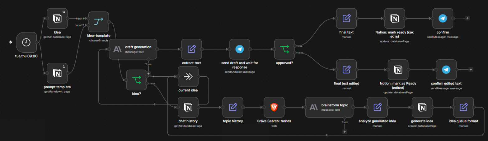

# LinkedIn Content Automation — n8n + Claude + Notion + Telegram

An n8n workflow (23 nodes) that prepares LinkedIn posts twice a week: Claude writes the draft, a human approves or edits it in Telegram, and Notion keeps the queue and the history. When the idea queue is empty, the workflow researches current trends and proposes the next topic itself.

## What it does

1. **Schedule** — runs every Tuesday and Thursday at 09:00.
2. **Notion** — takes the oldest idea with status `Idea` and loads the style guide (system prompt) from a Notion page.
3. **Claude (draft generation)** — writes the post draft using the topic, pillar, language and notes, following the style guide.
4. **Telegram (send and wait)** — sends the draft and pauses the workflow until a reply arrives.
5. **Human-in-the-loop branch**
   - reply `ok` / `yes` → the original draft is approved;
   - any other text → that text is used instead of the draft.
6. **Notion** — sets status `Ready` and saves the final text; Telegram confirms.

### Autonomous branch — when the idea queue is empty

1. **Notion** — reads the last 20 used topics so nothing is repeated.
2. **Brave Search** — fetches current AI-automation trends as fresh context.
3. **Claude (brainstorm topic)** — proposes the next topic as strict JSON (`pillar`, `topic`, `note`), rotating between 4 content pillars.
4. **Language rotation** — the post language (EN / PT) is set by code, alternating with the last published post, not left to the model.
5. **Notion** — creates the new idea and sends it back into the main flow.

## Design decisions

- **Nothing is marked ready without human approval** — the model drafts, a person decides.
- **Prompt lives in Notion, not in the workflow** — the style guide can be changed without touching n8n.
- **Deterministic where it matters** — JSON parsing with fallback cleanup of markdown fences, and language alternation handled in an expression instead of by the LLM.
- **Separate Telegram bot** for this workflow, isolated from client notifications.

## Stack

n8n Cloud · Claude API (Anthropic node, claude-sonnet-5) · Notion API · Telegram Bot API · Brave Search API

## How to import

1. In n8n: **Workflows → Import from file** → `workflow.json`.
2. Connect your own credentials (Notion, Anthropic, Telegram, Brave Search).
3. Replace the placeholders: `YOUR_NOTION_DATA_SOURCE_ID`, `YOUR_PROMPT_PAGE_ID`, `YOUR_TELEGRAM_CHAT_ID`.
4. Notion database properties used: `Status` (select: Idea / Ready), `Pillar` (select), `Language` (select), `Note` (text), `Post Draft` (text).

No credentials or personal IDs are included in this export.

---
Author: Artem Galyeyev · [GitHub](https://github.com/automatept-ai-pt)
